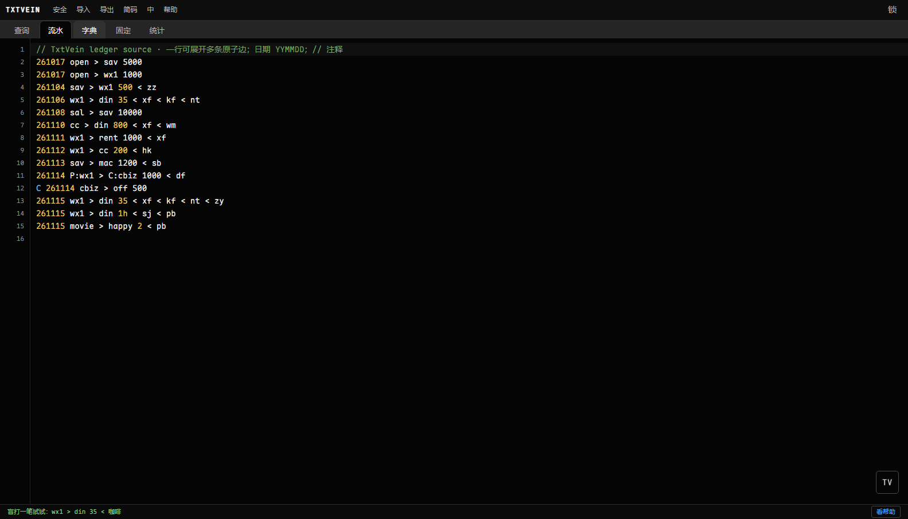
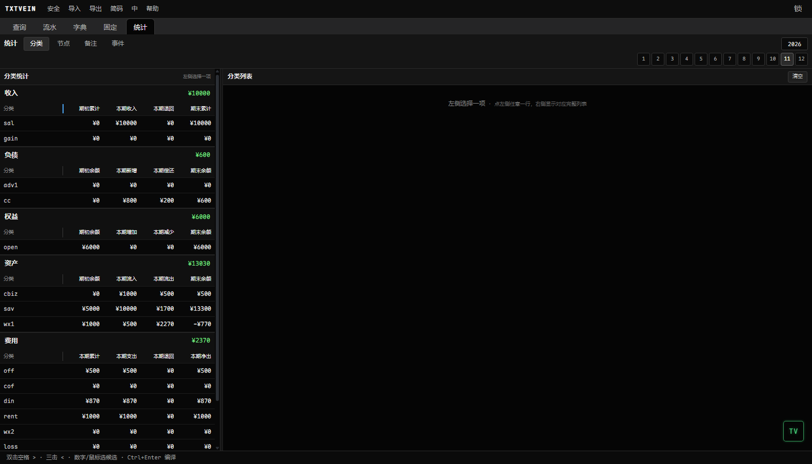
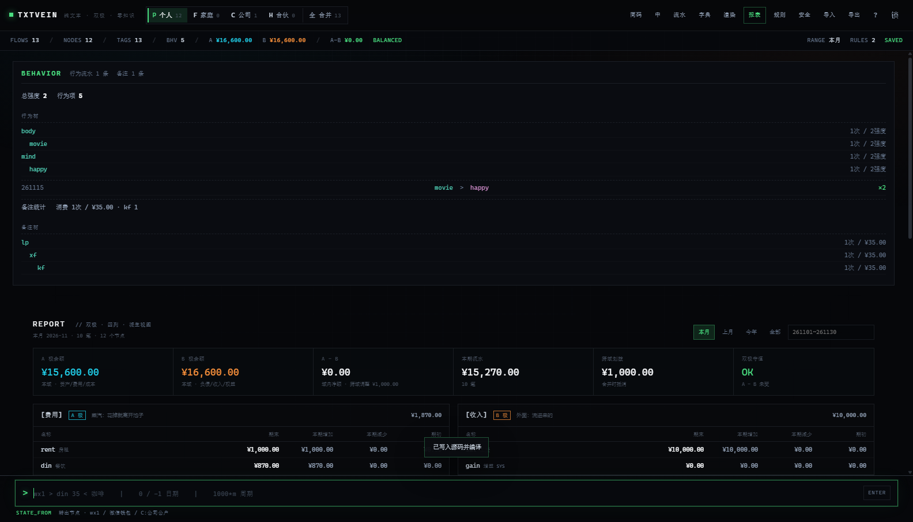
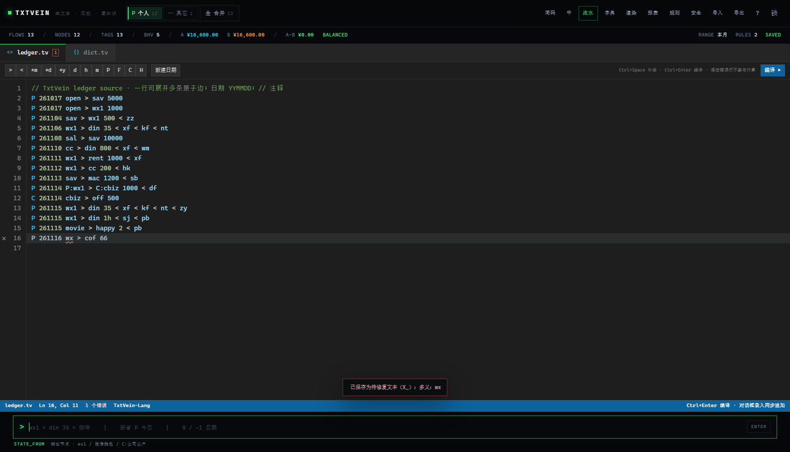
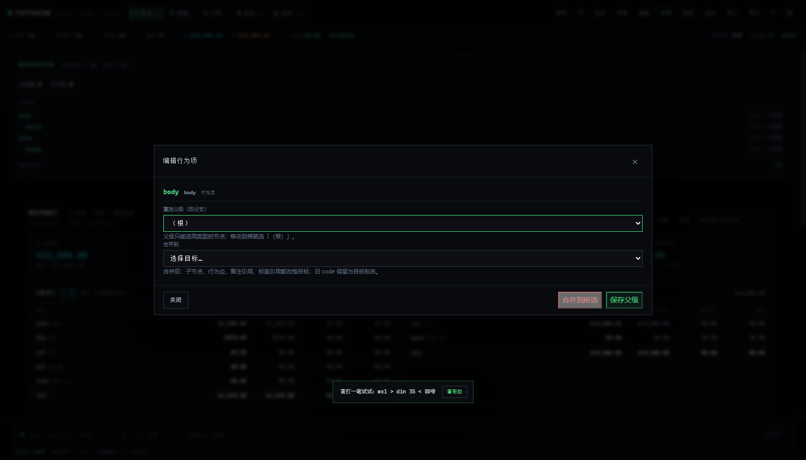
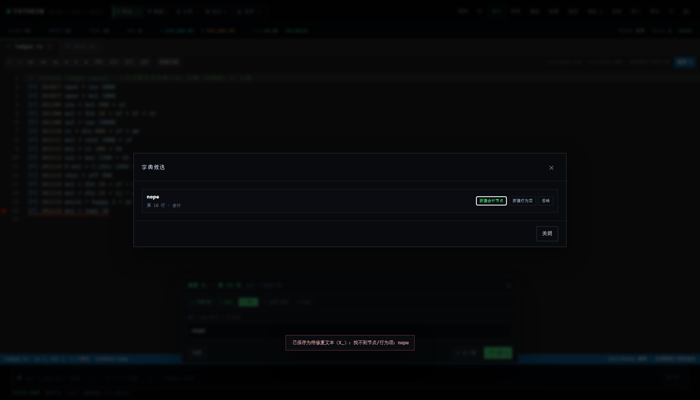
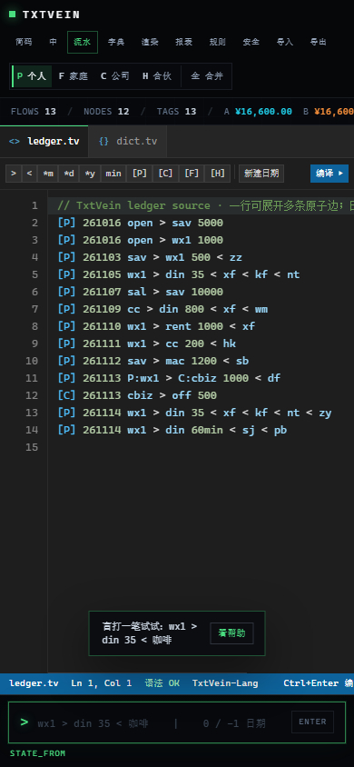

# TxtVein · 纯文本双极账本

> **后台 ID 图是唯一数据事实；编辑器里的 `ledger.tv` / `dict.tv` 是它的投影与手稿。**
> 抛弃借贷分录，只保留「转出 / 转入」；先有 `>`，才有账；`<` 是备注/行为标签。
> 错误行不当场丢弃：它仍是纯文本 `X_`，只是不参与计算。

单文件成品：**[`TxtVein.html`](TxtVein.html)** —— 双击即开，无服务器、无第三方依赖、不联网。
开发入口：[`index.html`](index.html)（外链 `css/` 与 `js/`，用 `python serve.py` 起本地服务）。















---

## 一、快速开始

| 方式 | 适合 | 说明 |
|---|---|---|
| 双击 `TxtVein.html` | 最快 | `file://` 下 localStorage 可用；导出走浏览器下载 |
| 双击 `dev.cmd` | **本地调试推荐** | 起 `127.0.0.1:8899`，自动打开浏览器；改 `css/js` 后 F5 |
| 双击 `start.cmd` | 快速打开 | 与 `dev.cmd` 相同，起 `8899` |
| `python serve.py 8899` | 改源码 / 自动化 | `python serve.py 8899 --no-open` 不弹浏览器 |

> 调试细节（Console 入口、localStorage、断点、E2E、远程调试、常见问题）见 **[`DEBUG.md`](DEBUG.md)**。

第一次打开：**设主密码（≥4 位）** → 进入示例账本（13 节点 / 13 标签 / 13 笔流水 / 3 条周期规则 / 2 条事件规则）。
示例里故意留了冲突简码：`wx` 同时指向「微信钱包」和「维修费」。敲 `wx` 会弹候选；只有多个候选同码时才按 `2` 编号为 `wx2`，普通候选只插入简码，不写别名。

> 忘记密码 = 数据永久销毁；没有服务器、没有找回。请自己保管 `ledger.txt + dict.json` 明文导出。

---

## 二、它是什么

TxtVein 是一个 **基于纯文本、无分录、双极图论** 的极简账本引擎。

五条设计公理：

1. **后台 ID 图是唯一数据事实**：编辑器里的 `ledger.tv` / `dict.tv` 是投影与手稿；ID 不出现在界面。
2. **双极无分录**：A 极（资产/费用/成本）转入增加、转出减少；B 极（负债/收入/权益）转出增加、转入减少。一笔 Event 两端都在，数学上天然平账。
3. **分层 ID**：会计 `N_` / `E_`，备注 `T_` / `X_`，行为 `H_` / `B_`，派生 `C_` / `R_`。改名只改字典，历史流水一行不动。
4. **多域隔离**：`P` 个人 / `F` 家庭 / `C` 公司 / `H` 合伙。独立视角只看本域；合并视角把跨域内部划拨单列并抵消。
5. **灯下黑**：底层是 ID、哈希、AES-GCM；界面上是 CM5 源码编辑器、4 种展现层和极简报表。

---

## 三、源码语法

```text
[域] [日期] 转出 > 转入 金额 < 标签 < 标签
[域] [日期] 金额 < 归属分类 < 关键字 关键字
[域] [日期] 行为项 > 行为项 强度
```

```txt
wx1 > din 35 < 咖啡 < 拿铁
261115 35 < 餐饮 < 星巴克 拿铁
261115 看电影 > 开心 1
```

- `>` 是流向符：会计段是资金，行为段是强度。
- `<` 是语义收敛符：进入备注标签层级。
- 一条源码行可以展开多条原子边：`微信 > 晚餐 > 开心 120 1` → `E_ 微信>晚餐 120` + `B_ 晚餐>开心 1`。
- 金额底层一律整数分；`35` → `3500`，`3.5k` → `350000`。
- 日期 `261115`（YYMMDD）；`0` 今天、`-1` 昨天、`-2` 前天、`+1` 明天。相对日期落盘前固化成绝对日期，并按日期自动插到对应位置。
- 行为强度是任意正整数，不是金额。
- 时间单位 **`d/h/m`**：`1d = 24h = 1440m`，`1h = 60m`；输入 `90m`，源码/报表显示 `1h30m`；`min` / `′` 仅作旧写法兼容。
- 用户界面只出现简码/明文；`N_` / `E_` / `B_` 这类底层 ID 不出现在流水、报表、气泡里。
- 错误行仍是纯文本 `X_`，单波浪线只标当前出错 token；不参与计算，但不会丢。

### 3.1 常用写法

| 输入 | 含义 |
|---|---|
| `wx1 > din 35` | 从微信转出 35 到餐饮 |
| `wx1 > din 35 < 咖啡 < 拿铁` | 加两级标签（`咖啡` 父、`拿铁` 子） |
| `sav > wx1 > din 1000` | 链式转移，展开为两笔同时间戳流水 |
| `sav > wx1 > din 1000 995` | 多金额链：差额 5 元自动进「损耗」池 |
| `261110 wx1 > din 12.5` | 指定日期 |
| `-1 wx1 > din 35` | 昨天（落盘为绝对日期，自动排到昨天） |
| `-1 微信 > 咖啡 80` | 昨天的花费；自动补昨天日期并按日期插入 |
| `P:wx1 > C:cbiz 1000 < 垫付` | 跨域转移；必须写明确前缀 |
| `wx1 > din 90m < 时间` | 时间代币；存 90 分钟，显示 `1h30m`；不进金额余额 |
| `261115 35 < 餐饮 < 星巴克 拿铁` | 备注：两级统计，不要求转出/转入 |
| `261115 看电影 > 开心 1` | 行为：行为项 > 行为项，强度 1 |
| `261115 微信 > 晚餐 > 开心 120 1` | 会计 + 行为叠加，后台两条原子边 |

### 3.2 编辑器

- **双击空格** → `>`；**三击空格** → `<`；候选打开时单击空格也可确认当前候选。
- 编辑器光标处同样支持双击/三击空格；补全弹窗可用鼠标点击。
- 简码候选支持 `1 2 3` 数字选择、鼠标点击、`↑↓` + `Tab/Enter`；默认日期今日，`P` 域不写前缀。
- **代码页内** `ledger.tv` / `dict.tv` 两个 CM5 编辑器，行号、语法高亮、单波浪线、补全、运算符工具条。
- **顶栏菜单**：安全 / 导入 / 导出 / 简码 / 中英 / 帮助，放在 logo 后面；
- **五个圆角页签**：查询 / 流水 / 字典 / 固定 / 统计；
- **统计页四页签**：分类 / 节点 / 备注 / 事件（行为）；左侧完整统计表、右侧对应完整列表，左右独立，右侧可拖宽，支持 1–12 月切换。
- **查询页**：一屏三段独立查询，默认今天 / 本月 / 本年，每段独立日期、转出、转入、金额、备注条件和「清空」。
- **固定页**：`[PLAN]` 固定收支 + `[RULES]` 自动规则，纯文本编辑；
- **右下角 TV 气泡**：点击展开单输入框，可拖动位置；手机不再被固定输入条占住。
- **字体**：优先 `JetBrains Maple Mono`，内置 `Maple Mono Web` 兜底；高对比深黑，编辑器不做灰底。
- **输入框上方反馈栏**：有反馈显示反馈，无反馈显示光标、错误数和快捷键提示；蓝色状态条已移除。
- **VS Code Dark+ 深灰**：15px 基准、14px 编辑器；去掉网格和光晕，字号不再依赖浏览器 110% 缩放。
- **Ctrl+Space** 补全；**Ctrl+Enter** 编译；`>` / `<` / `*m` / `*d` / `*y` / `d` / `h` / `m` 可点工具条插入。
- **顶部域栏已移除**：所有流水在同一个列表里；不写域即 `P`，只有显式写 `F` / `C` / `H` 才记录为对应域。
- 编辑区可切 4 态（简码/明文 × 中文/英文）；错误行原位保留，合法行重投影；跨域自动补 `P:`/`C:` 前缀。
- 对话框录入仍保留：成功写源码，失败也先写成 `X_` 纯文本，并把输入框留在「第 N 行待修复」状态；改完回车替换原行，不弹窗、不抢光标。
- **行为树/备注树节点可点**：重挂父级、合并；合并后行为边/备注/标签引用改指目标，旧 code 保留别名。
- **字典候选**：未知节点只进「候选」，确认后建会计节点或行为项；一波事务写 ID 图并重编译。
- **明文单文件导出前校验**：重读并比对流水/行为/节点/标签/行为项/备注/错误行数量，检查段落与 ID 泄露。
- **删除**：选中行后按 `Delete`，删对应源码行；toast 提供一次「撤销删除」。

---

## 四、后台数据格式

### 4.0 后台单位（唯一一层做换算）

| 类型 | 输入单位 | 后台存储 | 换算 |
|---|---|---|---|
| 金额 | 元 / `k` | **整数分 `amountCents`** | `35` → `3500`；`3.5k` → `350000` |
| 时间 | `d/h/m`（`min`/`′` 兼容） | **整数分钟 `minutes`** | `1d=1440`、`1h=60`、`1m=1`；`1d2h30m` → `1590` |
| 行为 | 正整数强度 | **整数 `weight`** | 不做金额/时间换算 |

- 源码是人的单位；编译后 ID 图只存整数；`ledger.txt` 金额写整数分，时间写 **总分钟 + `m`**（如 `90m`），避免与金额混淆。
- 解析入口唯一：`amount.parseAmount()` / `amount.parseTime()` / `amount.parseQuantity()`。
- 展示分解：`1590` → `1d2h30m`，`90` → `1h30m`，`60` → `1h`，`30` → `30m`；`ledger.txt` 仍写 `1590m` / `90m`。

### 4.1 `ledger.txt`

```txt
# TxtVein ledger · 纯文本唯一事实源
# FORMAT: 1
# VAULT_ID: 8a2b1c3d
# LINK: <字典 body 的 SHA-256>
# 域: P 个人 / F 家庭 / C 公司 / H 合伙
# 金额: 整数分；90m 为时间代币；标签为 T_ID
P 261110 N_001 > N_002 3500 T_01
P 261110 N_001 > N_002 90m T_time
P 261111 N_002 > N_001 99500 ^C_001

[PLAN]
R_001 active: 0 N_001 > N_004 100000 T_02 *m last_run=261111
[RULES]
R_101 active: keywords=(外卖)&amount<10000 -> N_001 > N_003 tags=T_05,T_02 name=外卖
```

- 每行一笔原子有向边；`^C_001` 是链式因果的可选标记。
- `[PLAN]` 是周期规则；`[RULES]` 是事件规则（预测模板）。
- 时间代币行金额写 `90m`（后台存 90 分钟；编辑器/报表显示 `1h30m`），`amountCents = 0`，只进时间统计。
- 流水只写 ID；改名不会改这里。

### 4.2 `dict.json`

```json
{
  "format": "txtvein-dict",
  "version": 1,
  "vaultId": "8a2b1c3d",
  "link": "<流水 body 的 SHA-256>",
  "meta": { "nextNode": 14, "nextTag": 14, "nextEvent": 20, "nextChain": 2 },
  "nodes": {
    "N_001": {
      "zh_name": "微信钱包", "en_name": "WeChat Wallet",
      "zh_code": "wx", "en_code": "wc",
      "polarity": "A", "type": "资产", "form": "fluid",
      "domain": "P", "parent_id": "", "weight": 120
    }
  },
  "tags": {
    "T_01": {
      "zh_name": "咖啡", "en_name": "Coffee",
      "zh_code": "kf", "en_code": "coffee",
      "domain": "P", "parent_id": "T_02", "weight": 20, "kind": "plain"
    }
  },
  "aliases": { "wx": ["N_001", "N_008"], "wx1": ["N_001"], "wx2": ["N_008"] }
}
```

- `type` 六选一：资产 / 费用 / 成本 / 负债 / 收入 / 权益；极性由类型决定。
- A 极形态 `form`：`fluid` 流体、`ice` 冰块、`steam` 蒸汽；B 极为 `outside`。
- `aliases` 可以多义（`wx` 两个 ID）；只有同码候选才生成 `wx1`/`wx2` 编号别名。
- 字典是唯一能解释 ID 的文件；丢了字典，流水就只剩 `N_001`。

### 4.3 哈希互锁

`ledger` 的 `# LINK` 指向字典 body 的 SHA-256；`dict.link` 指向流水 body 的 SHA-256。

**两个 `LINK` 字段本身不参与各自的哈希**（否则互为哈希会形成死循环）：

```text
Hash_A = SHA256(ledger 去掉 # LINK 行)
Hash_B = SHA256(dict 去掉 link 字段，键排序后的 canonical JSON)
ledger.LINK = Hash_B
dict.link   = Hash_A
```

导入时同时校验 `VAULT_ID` 与两条 SHA-256；不匹配会拦下，可勾选「强制导入」越权（会写明警告）。

---

## 五、存储、加密、导出

### 5.1 本地保险库

- 盘上只有 `{ v, iterations, salt, iv, ciphertext, updatedAt }`（`localStorage['txtvein:v2:vault']`）。
- PBKDF2-SHA-256 **150,000** 次 → AES-GCM-**256**；盐 16B、IV 12B，每次保存换新 IV；密钥不可导出，只在内存。
- 刷新 / 锁定即丢密钥；没有服务器、没有后门。

### 5.2 三种导出模式

| 模式 | 文件 | 说明 |
|---|---|---|
| 明文 | `ledger.txt` + `dict.json` | 全人类可读；适合 Git / 记事本 / 迁移；不受密码保护 |
| 初级密文 | `ledger.shadow` + `dict.vault` | 流水是纯 ID 明文；字典加密。可公开流水、藏住语义 |
| 深度密文 | `ledger.enc` + `dict.enc` | 两份都加密；解开流水仍只看到 ID，还要再解字典 |

加密文件带 ASCII 装甲：

```txt
# [SECURE_START: P, AES-GCM-256]
...base64...
# [SECURE_END]
```

解析器只提取起止标记之间的 Base64；缺结束标记会报「截断」，有污染字符会报错，旁边写日记也不影响。

### 5.3 导入

- 双文件一起导入；只给一个文件会拦下并提示缺字典。
- 支持 `.txt / .json / .shadow / .vault / .enc`；按内容识别，不只看扩展名。
- 支持旧版文脉明文（old1 合订账本 / old2 的 `## 节点` + `## 流水`）：自动把旧「期初金额」转成「期初权益 → 节点」的真实流水，旧三列备注转成标签层级。
- 加密文件需要密码；密码错误不会进入账本。

---

## 六、界面

### 6.1 宽屏多窗格

| 窗格 | 内容 |
|---|---|
| Pane 0 | 全局时间流（Event） |
| Pane 1 | A 极 · 资产池（资产 + 成本/冰块） |
| Pane 2 | B 极 · 外部池（负债 / 收入 / 权益） |
| Pane 3 | 费用 · 蒸汽池 |

- 点击事件行选中；双击原地编辑。
- 点击节点行把时间流筛到该节点，再点一次取消。
- 窄屏（≤820px）自动变成单窗格横向滑动，`scroll-snap` 吸顶。
- 行是虚拟滚动渲染，只画可视区。

### 6.2 四态渲染

| 模式 | 语言 | 示例 |
|---|---|---|
| 简码 | 中文 | `wx1 > din 35 < kf` |
| 简码 | 英文 | `wx1 > din 35 < coffee` |
| 明文 | 中文 | `微信钱包 > 餐饮 35 < 咖啡` |
| 明文 | 英文 | `WeChat Wallet > Dining 35 < Coffee` |

`Ctrl/Cmd + Shift + P` 切简码/明文；`Ctrl/Cmd + Shift + L` 切中/英。
冲突简码会自动显示为 `wx1 / wx2`，保证屏幕上不会出现两个 `wx`。

### 6.3 报表

- **双极四列**：每类按「期末 / 本期增加 / 本期减少 / 期初」列出；A 极与 B 极合计。
- **域内净额**：独立域视角会把跨域对外划拨加回，显示「域内净额」而不是凭空少 1000。
- **能量审计**：增益 / 阻抑 / 无标签流失；按节点排行。
- **时间代币**：`d/h/m` 统计，不进入金额余额。
- **链式因果**：`A > B > C 100 995` 展开的原子边与损耗/增益。
- **多域合并**：内部跨域划拨单列并抵消，只显示真正流出总盘子的部分。

### 6.4 快捷键

| 键 | 作用 |
|---|---|
| `Enter` | 落盘 / 气泡选中 |
| `↑ ↓` | 行间穿梭 / 气泡选择 |
| `Tab` | 补全气泡 / 采用预测 |
| `Ctrl+Z` | 撤销刚生成的歧义编号 |
| `Delete` | 删除选中的流水 |
| `Ctrl+S` | 立即保存 |
| `Ctrl+R` | 规则面板 |
| `Ctrl+Shift+P` | 简码 / 明文 |
| `Ctrl+Shift+L` | 中文 / 英文 |
| `Ctrl+Shift+K` | 锁定 |
| `Alt+1 / 2` | 流水 / 报表 |
| `?` | 帮助 |

---

## 七、代码结构

```text
TxtVein/
├─ TxtVein.html           ← 单文件成品（node tools/build.cjs 生成，不要手改）
├─ index.html             ← 开发入口（外链 css/js）
├─ css/
│  ├─ base.css            ← 色彩、门禁、模态、按钮
│  ├─ ledger.css          ← 多窗格、行、单输入框、气泡
│  ├─ report.css          ← 双极四列、能量、时间、链、域
│  └─ panels.css          ← 规则/字典/文本/导入导出/帮助
├─ js/
│  ├─ core/               ← 零 DOM，可在 Node 下直接测
│  │  ├─ text.js          ← 归一化、切行、宽度
│  │  ├─ amount.js        ← 元/分、k 折叠、时间代币
│  │  ├─ date.js          ← YYMMDD、相对日期、区间、周期
│  │  ├─ dict.js          ← 六类/双极、别名、树、四态、显示简码
│  │  ├─ parser.js        ← TxtVein-Lang：绑定、链式、标签、周期
│  │  ├─ calc.js          ← 双极余额、区间、域、标签、时间
│  │  ├─ domain.js        ← 多域隔离/合并/接口节点
│  │  ├─ rules.js         ← [PLAN] / [RULES] 解析与到期生成
│  │  ├─ report.js        ← 双极四列/能量/时间/链/域
│  │  ├─ ledger-file.js   ← ledger 序列化/解析/哈希
│  │  ├─ dict-file.js     ← dict 序列化/解析/canonical 哈希
│  │  ├─ crypto.js        ← PBKDF2 + AES-GCM + SHA-256
│  │  ├─ envelope.js      ← ASCII 装甲、截断/污染检测
│  │  ├─ example.js       ← 示例账本
│  │  └─ legacy.js        ← old1/old2 明文导入
│  ├─ browser/
│  │  ├─ store.js         ← localStorage 加密保险库 + CAS
│  │  └─ files.js         ← 下载 / 读取 / 剪贴板
│  └─ ui/
│     ├─ dom.js           ← DOM 小工具
│     ├─ gate.js          ← 设密码 / 解锁 / 重置
│     ├─ editor.js        ← CM5 双文件 / lint / hint / 工具条
│     ├─ panes.js         ← 四窗格 + 虚拟滚动
│     ├─ report-view.js   ← 报表 DOM
│     ├─ input.js         ← 单输入框 / 双空格 / 气泡 / 幽灵撤销
│     ├─ panels.js        ← 规则/导入导出/帮助/密码
│     └─ app.js           ← 唯一状态与编排
├─ vendor/codemirror/     ← CM5 + hint/lint/matchbrackets/active-line（MIT）
├─ tests/                 ← node --test（108 条）
├─ tools/
│  ├─ build.cjs           ← 把 index.html 内联成单文件
│  ├─ check.cjs           ← 工程门禁（121 项）
│  ├─ cdp.py              ← Chrome DevTools 小助手
│  ├─ e2e.py              ← 浏览器端到端（52 项断言）
│  ├─ smoke_file.py       ← file:// 单文件冒烟
│  └─ smoke.py            ← 快速截图/冒烟
├─ docs/screens/          ← 截图
├─ serve.py / start.cmd / dev.cmd / stop-dev.cmd  ← 本地服务与调试
├─ DEBUG.md               ← 本地调试环境说明书
├─ README.md · STATUS.md · HANDOFF.md · NEXT.md
└─ LICENSE                ← AGPL-3.0
```

**为什么 core 零 DOM**：账本的真相必须能在 `node --test` 下直接跑；门禁会检查 `document` / `window` / `localStorage` 不出现在 `js/core/`。

**为什么单文件是构建产物**：`TxtVein.html` 由 `index.html` 内联 `css/` 与 `js/` 生成。改源码后运行 `node tools/build.cjs`，不要手改产物。

---

## 八、验证

```powershell
cd D:\myproject\TxtVein

node --test tests/*.test.cjs      # 108 条核心测试
node tools/build.cjs              # 生成 TxtVein.html
node tools/check.cjs              # 121 项工程门禁
python serve.py 8899              # 另开一个终端（E2E 用）
python tools/e2e.py               # 52 项浏览器断言（需先起 8899 服务）
python tools/smoke_file.py        # file:// 单文件冒烟（含设密码 / 刷新解锁）
```

> 也可以不服务器直接跑：`$env:TXTVEIN_URL='file:///D:/myproject/TxtVein/index.html'; python tools/e2e.py`。

`e2e.py` 覆盖：设密码、CM5 双编辑器、三段查询、固定页、三栏统计、行为项自动建、行为/备注/错误行、明文单文件导出回导、刷新解锁、错误密码、锁定。

> E2E 使用独立 Chrome profile（`_tmp_cdp_profile/`），不会碰你的日常浏览器。

---

## 九、边界（诚实列出）

1. **没有多币种**：金额只有一个整数分字段；引入币种需要给 Event 增加 `currency` 字段。
2. **没有自动锁屏**：只能手动 `Ctrl+Shift+K` 或关页面；后续可加空闲计时。
3. **localStorage 5–10MB**：大账本请用文件导出；没有 IndexedDB 版本。
4. **多标签页不合并**：保存用密文 CAS，另一个窗口先写过会拒绝覆盖并提示刷新。
5. **没有深水掩码/诱饵头**：v1.1 把它列为高级可选；当前只保留标准 ASCII 装甲与截断/污染检测。
6. **没有穿戴设备 / 多智能体审计**：v1.1 的扩展模块，未进入 MVP。
7. **时间代币是并行账**：`1h` 事件 `amountCents=0`，只进时间统计；它不是货币金额。
8. **标签允许自动创建**：节点绝不静默创建；标签是语义层，会在 toast 里明示「新建标签」。
9. **跨域用显式前缀代替镜像双记**：`P:微信 > C:公户` 是一笔真实边；报表按域边界抵消，不生成第二笔镜像，避免同一笔钱被算两次。
10. **单个 `<` 块内空格 = 同级**：`< 消费 < 咖啡 拿铁` 中 `咖啡` 与 `拿铁` 同级；层级块之间是父子。
11. **`form` 是展示层形态**：流体/冰块/蒸汽只影响报表文案，不改变双极计算公式。
12. **没有服务端**：所有解析、密钥派生、加解密都在本地内存；没有同步、没有账号。
13. **没有 `@每天` 批量递延**：v1.1 把它列为 MVP 可选；当前只有 `*d*m*y` 单规则。
14. **极性软校验未做**：解析器不阻止任何 A/B 路径组合（例如收入直接流向负债）；只校验节点存在、金额、域前缀。
15. **不完整输入不生成草稿行**：只写在转出节点时，输入保留并标红提示，不会静默入账，也不会伪造一条 `0 金额` 的草稿。
16. **未做 1 万 / 10 万行压测**：虚拟滚动已实现，但没有 `bench.py` 的正式数据；见 `NEXT.md` P2。
17. **事件定义中枢/雷达图是部分实现**：规则面板可看/取消/删除 + 预测模板；三栏拼装台与雷达图未做。

---

## 十、与 v1.1 文档的对应

| v1.1 章节 | 落地 |
|---|---|
| §2 双极 / 原子转移 | `calc.js` `processTransfer`；每笔 Event 两端都在 |
| §2.3–2.5 纯文本 / ID / `>` | `ledger-file.js`、`dict.js`、`parser.js` |
| §2.6 链式 + 瞬态过桥 | `parser.expandPipeline`（在 `parseEntry` 内）；差额进 `N_sys_loss/gain` |
| §2.7 多域 | `domain.js`；显式前缀；合并抵消 |
| §3 数据模型与文本规范 | `ledger.txt` + `dict.json`；`E_` ID 运行时分配 |
| §4 TxtVein-Lang | `parser.js`：`>`、`<`、`#`、域、日期、`*d/*m/*y`、数字后缀 |
| §5 核心模块 | `dict/parser/calc/amount/crypto/store/rules/domain` 对应文件 |
| §6 单输入框 | `ui/input.js` + `ui/app.js` 状态提示/气泡/幽灵撤销/预测 |
| §7 渲染 | `ui/panes.js` DOM + 虚拟滚动；`report-view.js`；四态；工业配色 |
| §8 多域报表 | `domain.js` + `report.js` + `report-view.js` |
| §9 规则/事件 | `rules.js` + `panels.showRules`；周期生成/取消；事件规则预测 |
| §10 存储/加密 | `crypto.js`、`envelope.js`、`browser/store.js`；三模式导出/双文件校验 |
| §11 报表/生命能量 | `report.js`：双极四列、时间代币、增益/阻抑、链式、域合并 |
| §12 扩展 | 未做穿戴/多智能体/隐写；见边界 |
| §13 路线图 | Phase 1–5 核心已落地；扩展见 `NEXT.md` |
| §14 验收 | `e2e.py` 逐条覆盖；见 `STATUS.md` |
| §15 三大铁律 | README/实现均以此为准 |

逐条验收对照见 [`docs/v1.1-acceptance.md`](docs/v1.1-acceptance.md)；分层与不变量见 [`docs/architecture.md`](docs/architecture.md)。

---

## 十一、名字与许可

**文脉 / TxtVein** 是 LifeVein 生态下的独立纯文本子项目。
「文脉负责极简输入，主软件负责宏大表达。」

代码 AGPL-3.0（见 [LICENSE](LICENSE)）。TxtVein 为作者未注册商标。

---

© 2026 · 纯文本是本体，表格只是视图。
